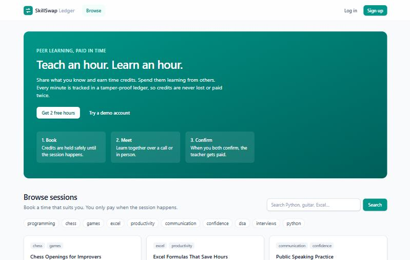
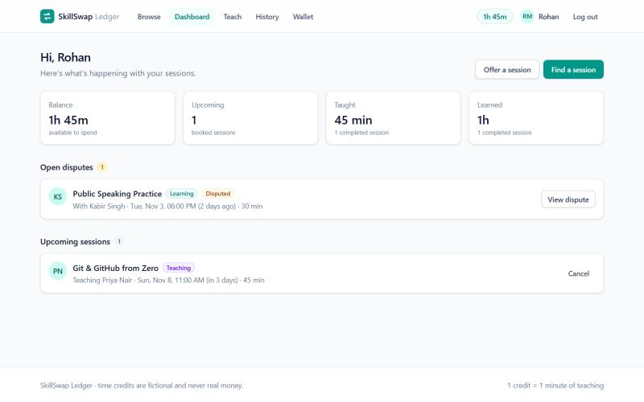
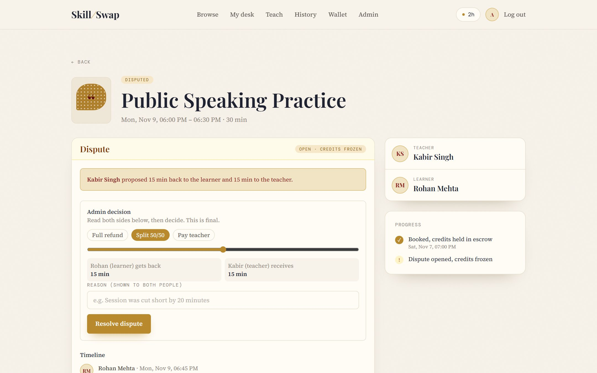
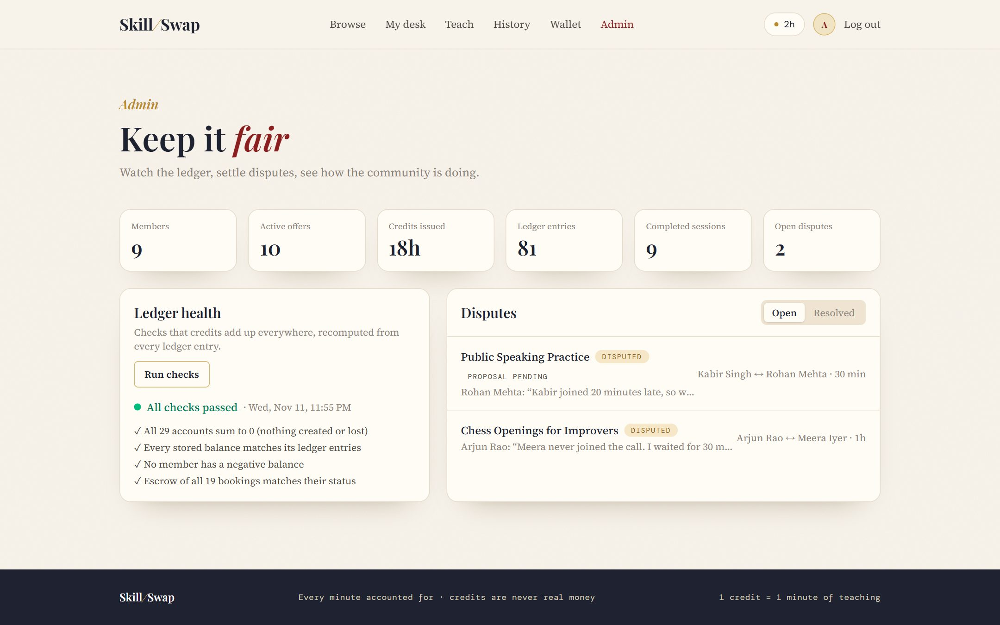
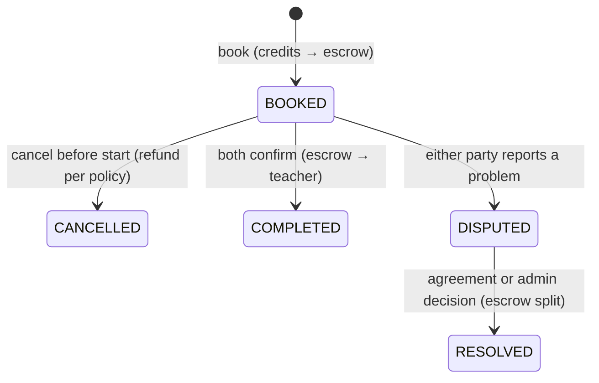
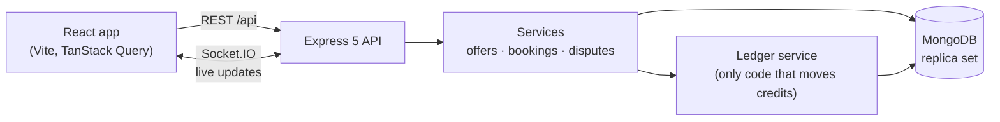

# SkillSwap Ledger

[](https://github.com/ShaishtaP/skillswap-ledger/actions/workflows/ci.yml)

A time-credit marketplace for peer learning. Teach what you know to earn time credits, then spend them learning from others.

Every credit movement is recorded in an **append-only, double-entry ledger** with **idempotent settlement**, so credits are never created, lost or awarded twice, even when requests are retried or arrive at the same moment.

**Live demo: [skillswap-ledger.onrender.com](https://skillswap-ledger.onrender.com)** · click *Try a demo account* on the login page ([details](#demo-accounts))

> Hosted on Render's free plan: if nobody has visited for a while, the first load takes 30–60 seconds while the server wakes up.



## Features

- **Offers and time slots.** Publish what you teach, pick its craft, say what learners will leave with, and add times; overlapping slots are rejected.
- **Gallery-style browsing.** Every session gets an original two-ink riso artwork, chosen from its skills; browse by craft, see member picks, new sessions and how often each was taught.
- **Escrow booking.** Booking a slot moves the learner's credits into a per-booking escrow account.
- **Two-party confirmation.** The teacher is paid only after both people confirm the session happened.
- **Cancellation policy.** Full refund more than 24h before (or if the teacher cancels); 50/50 inside 24h.
- **Disputes.** Credits stay frozen until the two people agree on a split or an admin decides.
- **Searchable learning history**, wallet statement and profile.
- **Live updates.** Socket.IO pushes booking and dispute changes to both people instantly.
- **Admin tools.** Ledger health checks, platform stats and a dispute queue.
- **Animated, accessible hero.** Riso ink shapes slide into registration and follow the mouse; live community numbers count up; everything turns off for people who prefer reduced motion.

| Dashboard | Dispute resolution | Admin |
|---|---|---|
|  |  |  |

## How the ledger works

Credits are counted in **whole minutes** (1 credit = 1 minute, so no rounding errors). Each movement is a transaction of two or more entries that **sum to zero**:

```
Alice signs up               mint            −120
                             user:alice      +120    → total 0 ✓

Alice books a 60-min session user:alice       −60
                             escrow:b1        +60    → total 0 ✓

Both confirm attendance      escrow:b1        −60
                             user:bob         +60    → total 0 ✓
```

| Guarantee | How it is enforced |
|---|---|
| Nothing created from thin air | Every transaction must sum to 0, so the whole ledger always sums to 0 |
| History can't be rewritten | Entries are insert-only; updates and deletes are blocked at the model layer |
| No double payouts on retry | Each transaction has a unique key (`settle:<bookingId>`) backed by a unique index |
| No overdraft under concurrency | Balance check and subtraction are one atomic conditional update inside the transaction |
| All or nothing | Ledger entries and the related status change commit in one MongoDB transaction |

### Race conditions handled (each one has a test)

| What could go wrong | Why it can't |
|---|---|
| Two learners book the same slot at once | The slot moves `OPEN → BOOKED` with a conditional update; MongoDB lets exactly one through |
| Teacher and learner confirm at the same moment | The second transaction conflicts, retries, sees both confirmations and settles; the `settle:` key makes a second payout impossible |
| Two parallel bookings spend the same credits | The balance update conflicts, so one transaction retries and fails the balance check |
| Both people cancel at once | Only one `BOOKED → CANCELLED` transition can succeed |
| Agreement and admin decision land together | Only one `OPEN → RESOLVED` transition can succeed; the `resolve:` key pays out once |
| Proposal changes just as it is accepted | Accepting includes the amount you saw; a changed proposal is rejected |

The admin **Ledger health** check recomputes everything from raw entries: the ledger total is 0, every stored balance matches its entries, no member is negative, and every booking's escrow matches its status.

### Booking lifecycle



## Architecture



- **Routes** handle HTTP only: validate input with Zod, call a service, return JSON.
- **Services** hold the business rules. Every multi-step change runs in a MongoDB transaction.
- **Ledger service** is the only code allowed to write ledger entries.
- In production one Node process serves both the API and the built React app.

## Tech stack

| Layer | Tools |
|---|---|
| Frontend | React 19, React Router, TanStack Query, Tailwind CSS 4, Vite |
| Backend | Node.js, Express 5, Mongoose 9, Zod, JWT, bcrypt, helmet, express-rate-limit |
| Realtime | Socket.IO |
| Database | MongoDB (Atlas in production, in-memory replica set for tests and demo) |
| Testing | Vitest, Supertest, mongodb-memory-server, socket.io-client |
| DevOps | GitHub Actions CI, Render Blueprint (`render.yaml`) |

## Running locally

Requirements: Node.js 22+.

### Quick demo (no database setup)

Starts a temporary in-memory database filled with demo data. Everything is wiped when you stop it.

```bash
npm run setup                    # installs server and client packages
npm run build --prefix client    # builds the website
npm run demo                     # open http://localhost:4000
```

### Development with your own MongoDB

```bash
cp server/.env.example server/.env   # then fill in MONGO_URI (Atlas) and JWT_SECRET
npm run dev:server                   # API on http://localhost:4000
npm run dev:client                   # website on http://localhost:5173 (in a second terminal)
```

To fill your database with the demo community (**this erases it first**):

```bash
cd server && npm run seed -- --reset
```

### Demo accounts

Password for all: `password123`

| Email | What to try |
|---|---|
| `aisha@skillswap.test` | Confirm a finished guitar session, then book something |
| `rohan@skillswap.test` | Accept the teacher's proposal in an open dispute |
| `meera@skillswap.test` | Teaches Python and DSA, has upcoming sessions |
| `admin@skillswap.test` | Run ledger health checks, resolve a no-show dispute |

Other members: `priya`, `daniel`, `kabir`, `sara`, `arjun` (all `@skillswap.test`).

## Tests

```bash
npm test
```

60 tests run against a real MongoDB replica set started in memory:

- **Ledger:** balanced legs, integer amounts, idempotency under 10 simultaneous retries, overdraft protection under parallel spends, append-only enforcement, tamper detection
- **Bookings:** escrow hold, five learners racing for one slot, rollback when credits are short, simultaneous confirmations settle once, all cancellation rules and races
- **Disputes:** freezing escrow, agreement, stale proposals, admin decisions, agreement vs admin race, access control
- **API and realtime:** full HTTP flow, validation, authorization, Socket.IO notifications and auth
- **Community:** taught counts, member picks, new offers, category filter, homepage stats and recent swaps
- **Demo data:** every scenario seeds correctly and leaves the ledger healthy

## API

| Method | Endpoint | Description |
|---|---|---|
| POST | `/api/auth/signup` · `/api/auth/login` | Create account / log in → `{ user, token }` |
| GET · PATCH | `/api/auth/me` | Current user / update profile |
| GET | `/api/wallet` | Balance and recent ledger entries |
| GET | `/api/offers?q=&skill=&category=` | Search active offers with taught count, member pick and new flags (public) |
| GET | `/api/offers/:id` | Offer with open slots (public) |
| GET | `/api/offers/mine` | Your offers with upcoming slots |
| POST · PATCH | `/api/offers` · `/api/offers/:id` | Create / update or pause an offer |
| POST | `/api/offers/:id/slots` | Add a time slot |
| DELETE | `/api/slots/:id` | Remove an open slot |
| POST | `/api/slots/:id/book` | Book a slot (credits → escrow) |
| GET | `/api/bookings?role=&status=&q=` | Your sessions, searchable |
| GET | `/api/bookings/:id` | One booking |
| POST | `/api/bookings/:id/confirm` · `/cancel` · `/dispute` | Confirm attendance, cancel, open a dispute |
| GET | `/api/disputes/:id` | Dispute with timeline |
| POST | `/api/disputes/:id/propose` · `/accept` · `/notes` | Propose a split, accept it, add a message |
| GET | `/api/community/stats` · `/api/community/recent` | Homepage numbers and recently completed sessions (public) |
| GET | `/api/admin/health` · `/api/admin/stats` · `/api/admin/disputes` | Admin only |
| POST | `/api/admin/disputes/:id/resolve` | Admin decision |

All errors look like `{ "error": { "code": "SLOT_UNAVAILABLE", "message": "...", "details": [...] } }`.

## Deployment

The app deploys as a single Render web service backed by MongoDB Atlas. See [docs/DEPLOYMENT.md](docs/DEPLOYMENT.md).

## Docs

- [docs/SPEC.md](docs/SPEC.md): full specification and rules
- [docs/DAILY_LOG.md](docs/DAILY_LOG.md): what was built each day
- [docs/DEPLOYMENT.md](docs/DEPLOYMENT.md): step-by-step deployment

## License

MIT
